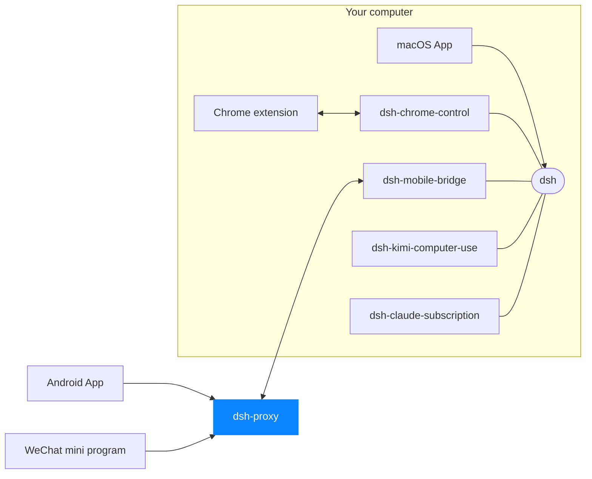

# dsh-proxy

The only public component of dsh mobile access. One TCP port, one client
contract, no disk, no state to restore.

```
Android / mini-program ──wss://host/tunnel──┐
                                            ├─> dsh-proxy ──one long link──> Mac (dsh-mobile-bridge)
Mac bridge ─────────────DSHB preamble───────┘
```

The proxy reads one byte to decide what a connection is:

- `0x16` — a TLS ClientHello. Terminate it and serve HTTP/1.1. The only route
  that does anything is `GET /tunnel` with an `Upgrade`.
- `DSHB` — a bridge dialling out. A Noise_XX handshake follows; the static key
  it proves becomes the routing key, and a minimal mux rides that link.

Anything else gets nothing back.

## The client contract

One WebSocket. Inside it, the bytes a phone used to put on a bare TCP socket:
the 37-byte `DSHC` preamble naming a bridge, then a **Noise_IK session with
the Mac**. The proxy unwraps WebSocket frames and forwards the bytes. It holds
no key that would let it read them, and it does not try.

Message boundaries carry no meaning: a client may send the preamble in six
frames or in one. Control frames are the only ones the proxy interprets, and a
ping is answered, because a mini-program's socket dies quietly without it.

WSS is what makes one contract serve every client: a WeChat mini-program may
not open a raw socket, but `wx.connectSocket` is a byte pipe like any other.
Nothing above the carrier had to change on either client - both already owned
a Noise stack sitting on a byte-stream seam.

## Authentication

| layer | proves | where |
|---|---|---|
| TLS 1.3 | the client reached the real proxy | here |
| Noise_IK | the device holds a paired static key | phone ↔ Mac |
| device allowlist | that key was approved during pairing | Mac |

`/tunnel` checks no token, and none could be checked: the session inside is
end to end, and the Mac is the authority. What the proxy owes this route is
**admission control**, not authentication, and it is deliberately cheap - no
decryption, no lookup:

| flag | default | bounds |
|---|---|---|
| `--max-clients-per-ip` | 64 | TLS clients one peer address may hold, claimed before the handshake |
| `--max-bridges` | 1024 | bridge links held at once, process-wide |
| `--max-bridges-per-ip` | 32 | bridge links held by one peer address |
| `--max-streams-per-bridge` | 2048 | phone streams one bridge carries at once |
| `--handshake-timeout-ms` | 10000 | a bridge's whole XX handshake |

Pairing happens inside the tunnel, between the phone and the Mac. So there is
no pairing route here, no token store and no state file: **the public
component keeps nothing worth stealing**, and a restart costs only the seconds
a bridge takes to reconnect.

## Run

```sh
cargo build --release
./target/release/dsh-proxy --listen 0.0.0.0:443 \
    --tls-cert /etc/dsh/fullchain.pem --tls-key /etc/dsh/privkey.pem
```

`--key` pins the bridge-link static key; without it one is generated and the
public half printed. `--tls-self-signed` mints a throwaway certificate for
local development. There is no unencrypted mode.

## Tests

`cargo test` runs 16 tests over real loopback sockets, against a bridge and a
phone written as independent implementations of the peers. The phone's
Noise_IK and transport framing live in `tests/common/phone.rs`, not in the
proxy, which is what makes these evidence rather than a mirror.

- `tests/pipe.rs` — the client contract: an end-to-end Noise session carried
  over WSS, a preamble split across seven-byte frames, ping answered with
  pong, an unknown bridge key told nothing.
- `tests/tunnel.rs` — the bridge link and mux: round trip, 3 MiB through the
  receive window, 50 concurrent streams, keepalive, the silent drops for
  unknown key / version / magic, per-IP refusal, stalled-handshake reaping,
  the exact stream budget under a race, one stream's flood costing only that
  stream, duplicate registration.

## Measured

Against the previous bare-TCP proxy, same bridge, same phone stack, same
payloads, with only the carrier different:

| | old | new |
|---|---:|---:|
| 4 B echo, 32 connections | 108 799 rps | **107 647 rps**, same CPU |
| 1 MiB bulk, 8 lanes | 743.9 MB/s | 603.3 MB/s, +33 % CPU |
| connection setup | 2 094/s | 1 384/s |

So the shape that actually carries RPC is free, and what TLS and WebSocket
framing cost is paid per byte and per connection: a fifth of the bulk
throughput, and a third of the connection rate. On a link that tops out
around 0.5 MB/s neither is the limit. Method, caveats and a correction to an
earlier unfair comparison: [BENCHMARKS.md](BENCHMARKS.md).

<!-- dsh-family:start -->
## The DSH App family

**DSH App** is a family of clients and plugins built for [DeepSeek Harness](https://github.com/deepseek-ai/deepseek-harness) (`dsh`). Every piece plugs into the **same** dsh on your computer, so sessions, models and plugins are shared everywhere — combine the ones you need. Downloads and docs: **[dshapp.github.io](https://dshapp.github.io/en/)**.



| | Project | What it does | Links |
| --- | --- | --- | --- |
| Clients | **macOS App**<br>`dsh-macapp` | Native SwiftUI client that hosts your local dsh and switches on every extension | [Overview](https://dshapp.github.io/en/products/macos/) · source coming soon |
|  | **Android App**<br>`dsh-androidapp` | DSH in your pocket: approvals, questions and notifications, end-to-end encrypted | [Overview](https://dshapp.github.io/en/products/android/) · source coming soon |
|  | **DSH Remote (WeChat)**<br>`dsh-miniapp` | No install: take over DSH from WeChat on iPhone or Android | [Overview](https://dshapp.github.io/en/products/miniapp/) · source coming soon |
|  | **Chrome extension**<br>`dsh-chrome-extension` | DSH in the browser side panel, and the executing half of browser control | [Overview](https://dshapp.github.io/en/products/chrome/) · source coming soon |
| dsh plugins | **Browser control**<br>`dsh-chrome-control` | Hands your signed-in Chrome to the agent as `mcp__chrome__*` tools | [Overview](https://dshapp.github.io/en/products/chrome/) · [Source](https://github.com/dshapp/dsh-chrome-control) |
|  | **Mobile bridge**<br>`dsh-mobile-bridge` | Serves dsh to paired phones over a Noise tunnel, without opening a port | [Overview](https://dshapp.github.io/en/products/android/) · [Source](https://github.com/dshapp/dsh-mobile-bridge) |
|  | **Computer use**<br>`dsh-kimi-computer-use` | Lets the agent operate Mac apps that have no API, in the background | [Overview](https://dshapp.github.io/en/products/cu/) · [Source](https://github.com/dshapp/dsh-kimi-computer-use) |
|  | **Claude subscription**<br>`dsh-claude-subscription` | Runs Claude models in DSH on your Claude Code subscription, no API key | [Source](https://github.com/dshapp/dsh-claude-subscription) |
| Infrastructure | **Relay** ← you are here<br>`dsh-proxy` | The only public piece of mobile access: one port, ciphertext only, no state | [Overview](https://dshapp.github.io/en/docs/crypto/) |
|  | **Website**<br>`dshapp.github.io` | Downloads, docs and release notes | [Overview](https://dshapp.github.io/en/) · [Source](https://github.com/dshapp/dshapp.github.io) |
<!-- dsh-family:end -->
