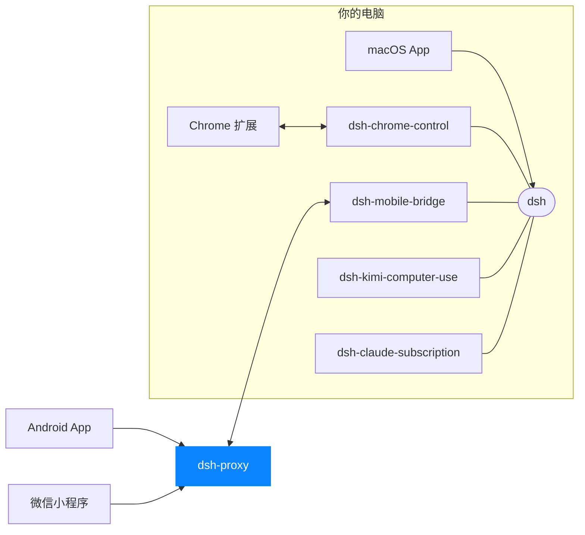

# dsh-proxy

[English](README.md)

[DSH App](https://dshapp.github.io/) 手机远程访问背后的公网中转。Android App、微信小程序和你 Mac 上的
[`dsh-mobile-bridge`](https://github.com/dshapp/dsh-mobile-bridge) 都是**主动连出**到它，所以 Mac
永远不用开端口。它是一个静态二进制、一个 TCP 端口，只转发密文，不往磁盘写任何东西。

```
Android / 小程序 ──wss://host/tunnel──┐
                                      ├─> dsh-proxy ──一条长连接──> Mac (dsh-mobile-bridge) ──> dsh
Mac bridge ───────DSHB 前导头─────────┘
          Noise_IK：手机与 Mac 之间端到端加密
```

## 你能得到什么

- **单端口，只有 TLS。** 手机和 bridge 共用同一个监听端口，没有明文模式。
- **只见密文。** 隧道里跑的是手机与 Mac 之间的 Noise_IK 会话，proxy 没有任何能解开它的密钥。
- **没有值得偷的东西。** 没有配对接口、没有 token 存储、没有状态文件。重启的代价只是 bridge 重连的那几秒。
- **所有客户端一份契约。** 微信小程序不能开裸 socket，但能开 WebSocket，所以 `wss://host/tunnel`
  同时服务两个客户端，客户端上层一行不改。
- **廉价的准入控制。** 按 IP、按 bridge 封顶，不解密、不查表。
- **一个文件就能部署。** CI 产出静态链接的 Linux 二进制，拷过去就能跑。

> **你需要自己部署吗？** 只有自建时才需要。`dsh-mobile-bridge` 默认指向一个公共实例
> （`dshproxy.wuhaolin.cn:8787`，已固定公钥），不自建也能用手机远程。

## 前置条件

- 一台公网可达的主机，开放一个 TCP 端口（默认 443）。
- 手机要连的那个域名的 TLS 证书，例如 Let's Encrypt 的 `fullchain.pem` / `privkey.pem`。手机会校验它。
- Rust stable，仅在从源码构建时需要。

## 安装

**预编译版（Linux x86_64）。** 每次推送 `main` 都会跑 [build.yml](.github/workflows/build.yml)：
测试、构建 musl 静态二进制、确认它能启动，然后连同 SHA-256 上传为 `dsh-proxy-linux-x86_64` 构件。
从 Actions 运行页下载后：

```sh
unzip dsh-proxy-linux-x86_64.zip
sha256sum -c dsh-proxy.sha256
install -m 755 target/x86_64-unknown-linux-musl/release/dsh-proxy /usr/local/bin/
```

**从源码构建。**

```sh
cargo build --release --locked             # -> target/release/dsh-proxy
# 和 CI 一样的 Linux 静态二进制（需要 musl-tools）：
rustup target add x86_64-unknown-linux-musl
cargo build --release --locked --target x86_64-unknown-linux-musl
```

## 运行

**1. 生成一次 bridge 链路密钥，并一直保留。** 任意 32 个随机字节都是合法的 X25519 私钥：

```sh
umask 077 && openssl rand -base64 32 > /etc/dsh/proxy.key
```

**2. 启动。**

```sh
dsh-proxy --listen 0.0.0.0:443 --key "$(cat /etc/dsh/proxy.key)" \
    --tls-cert /etc/dsh/fullchain.pem --tls-key /etc/dsh/privkey.pem
```

启动时会打印公钥，bridge 要固定（pin）的就是它：

```
dsh-proxy listening on 0.0.0.0:443
dsh-proxy public key I7bowv/d8y5NTR6N1ntxMm//NoElvLJbN6NDvZi3HTU=
```

**3. 检查。**

```sh
curl https://proxy.example.com/health      # {"ok":true}
```

**4. 让 Mac 上的 bridge 指向它**，写在 profile 的 `cordis.patch.yml` 里：

```yaml
- id: mobile-bridge
  config:
    proxyHost: proxy.example.com
    proxyPort: 443
    proxyPublicKey: I7bowv/d8y5NTR6N1ntxMm//NoElvLJbN6NDvZi3HTU=   # 上面打印的那一行
```

手机端不用配置：bridge 显示的配对码（`dshm://host:port/…`）里已经写明了 proxy 地址。

不传 `--key` 时每次启动都会生成新密钥，固定了 `proxyPublicKey` 的 bridge 会拒绝连接，直到你更新配置。
另外 `--key` 是命令行参数，同一台机器上的其他用户能从进程列表里看到它，所以请部署在你自己掌控的机器上。

本地开发可用 `--tls-self-signed` 生成一张 `localhost` 的临时证书，客户端需要信任它或跳过校验。

### 用 systemd 托管

```ini
# /etc/systemd/system/dsh-proxy.service
[Unit]
Description=dsh-proxy
Wants=network-online.target
After=network-online.target

[Service]
User=dsh
ExecStart=/bin/sh -c 'exec /usr/local/bin/dsh-proxy --listen 0.0.0.0:443 --key "$(cat /etc/dsh/proxy.key)" --tls-cert /etc/dsh/fullchain.pem --tls-key /etc/dsh/privkey.pem'
AmbientCapabilities=CAP_NET_BIND_SERVICE
NoNewPrivileges=yes
Restart=always

[Install]
WantedBy=multi-user.target
```

`dsh` 用户需要能读取密钥和两个 PEM 文件。证书只在启动时读一次，所以每次续期后都要重启服务
（例如放进 certbot 的 deploy hook）。重启只会让 bridge 重连一下。

## 配置

全部是命令行参数。`--help` 打印用法；参数错误时以状态码 2 退出。

| 参数 | 默认值 | 含义 |
|---|---|---|
| `--listen HOST:PORT` | `0.0.0.0:443` | 手机与 bridge 共用的唯一端口 |
| `--key BASE64` | 每次启动随机生成 | bridge 链路用的 32 字节 X25519 私钥 |
| `--tls-cert PEM` / `--tls-key PEM` | — | 证书链与私钥；不用自签名时两者都必填 |
| `--tls-self-signed` | 关 | 临时 `localhost` 证书，仅用于开发 |
| `--max-clients-per-ip N` | 64 | 单个来源地址可同时持有的 TLS 客户端数，在握手前就计数 |
| `--max-bridges N` | 1024 | 全进程同时持有的 bridge 链路数 |
| `--max-bridges-per-ip N` | 32 | 单个来源地址可持有的 bridge 链路数 |
| `--max-streams-per-bridge N` | 2048 | 一个 bridge 同时承载的手机流数 |
| `--handshake-timeout-ms N` | 10000 | bridge 整个 Noise_XX 握手的截止时间 |

## 工作原理

proxy 读第一个字节来判断连接类型：

- `0x16`：TLS ClientHello。终止 TLS，提供 HTTP/1.1。只有两个路由：带 WebSocket `Upgrade` 的
  `GET /tunnel`，以及 `GET /health`，其余一律 `404`。
- `DSHB`：bridge 主动连入。随后是 Noise_XX 握手，它证明的静态公钥就是路由键，
  链路上跑一个最小 mux（`OPEN` / `DATA` / `CLOSE` / `WINDOW`，每条流 256 KiB 窗口）。

其他任何东西都得不到一个字节的回应。

**客户端契约。** 一条 WebSocket。里面是手机以前直接写到裸 TCP 上的那些字节：37 字节的 `DSHC` 前导头
（`magic(4) + version(1) + bridge key(32)`）指明要连哪个 bridge，然后是**与 Mac 之间的 Noise_IK 会话**。
proxy 拆掉 WebSocket 帧、转发字节，它没有能读这些字节的密钥，也不打算读。

消息边界没有意义：前导头分六帧发还是一帧发都行。proxy 只解释控制帧，并且会回应 ping，
因为小程序的 socket 没有它就会悄无声息地断掉。

两个客户端在载体之上都不用改：它们本来就把 Noise 栈架在字节流接口上，而 `wx.connectSocket` 也只是一条字节管道。

## 安全

| 层 | 证明了什么 | 在哪儿 |
|---|---|---|
| TLS 1.3 | 客户端连到的是真的 proxy | 这里 |
| Noise_IK | 这台设备持有已配对的静态密钥 | 手机 ↔ Mac |
| 设备白名单 | 这个密钥在配对时被批准过 | Mac |

`/tunnel` 不校验任何 token，也无从校验：里面的会话是端到端的，Mac 才是权威。proxy 在这条路上欠的是
**准入控制**而不是身份认证，也就是上面的 `--max-*` 和 `--handshake-timeout-ms`，而且刻意做得很便宜：
不解密、不查表。指向未知 bridge 的手机、版本号或 magic 不对的 bridge，都会被直接丢弃，不回应。

配对在隧道内、手机与 Mac 之间完成，所以这个公网组件**没有任何值得偷的东西**。

proxy *能*看到的：对端 IP、bridge 路由键（只是标识，不是秘密，配对二维码里就有）、流量的大小和时间。

## 性能

与上一代裸 TCP proxy 对比：同一个 bridge、同一套手机端协议栈、同样的负载，只有载体不同。

| | 旧 | 新 |
|---|---:|---:|
| 4 B 回显，32 连接 | 108 799 rps | **107 647 rps**，CPU 相同 |
| 1 MiB 大块，并发 8 | 743.9 MB/s | 603.3 MB/s，CPU +33 % |
| 建连 | 2 094/s | 1 384/s |

RPC 形状的流量不额外花钱；TLS 与 WebSocket 分帧的开销按字节和按连接计：大块吞吐少约五分之一，建连速率少约三分之一。
在上限约 0.5 MB/s 的链路上，两者都不是瓶颈。测量方法、注意事项和对早先一组不公平对比的更正见
[BENCHMARKS.md](BENCHMARKS.md)。

## 常见问题

| 现象 | 原因与处理 |
|---|---|
| `provide --tls-cert and --tls-key, or --tls-self-signed` | 没有明文模式。同时传两个 PEM 文件，开发时可用 `--tls-self-signed`。 |
| `--key is not base64` / `private key must be 32 bytes` | 密钥必须是恰好 32 字节的 base64。用 `openssl rand -base64 32` 生成。 |
| 绑定 `:443` 报 `Permission denied` | 1024 以下端口需要 `CAP_NET_BIND_SERVICE`（见 systemd 单元）；或者监听高位端口，并把 bridge 的 `proxyPort` 改成一致。 |
| proxy 重启后 bridge 再也连不上 | proxy 没带 `--key` 启动，公钥变了，和 bridge 固定的不一致。加上 `--key` 重启，或更新 `proxyPublicKey`。 |
| 手机隧道建立后马上关闭，日志里什么都没有 | 它指向的 Mac 没有连到这台 proxy。未知 bridge 按设计静默丢弃。确认 bridge 状态里 `connected` 为真。 |
| 同一个 NAT 后面的手机被拒 | 该地址达到了 `--max-clients-per-ip`（64），调大即可。 |
| 续期证书后手机仍报证书问题 | 证书只在启动时加载，重启 proxy。 |

## 开发

```sh
cargo test --locked                                   # 与 CI 相同
cargo clippy --all-targets --locked -- -D warnings
```

`cargo test` 共 18 项测试，其中 17 项跑在真实的回环 socket 上，对端 bridge 和手机都是独立实现的。
手机端的 Noise_IK 和传输分帧在 `tests/common/phone.rs`，不在 proxy 里，所以这些测试才算证据而不是镜像。

- `tests/pipe.rs`：客户端契约。经 WSS 的端到端 Noise 会话、按 7 字节分片的前导头、ping 回 pong、
  超长 ping 被拒、按 IP 的隧道上限、未知 bridge 键得不到任何回应。
- `tests/tunnel.rs`：bridge 链路与 mux。往返、3 MiB 穿过接收窗口、50 条并发流、keepalive、
  未知键 / 版本 / magic 的静默丢弃、按 IP 拒绝、卡住的握手被回收、竞争下流预算不超额、
  单条流灌满只影响自己、重复注册。
- `src/noise.rs`：单元测试，确认 `snow` 与 `x25519-dalek` 推出的公钥一致，否则 bridge 固定的公钥 proxy 证明不了。

`tests/bench.rs` 是压测，标了 `#[ignore]`，由 `scripts/bench.sh <PORT_BASE>` 驱动，需要从 `38c1eab`
构建的旧 proxy（`OLD_BIN`）。

| 文件 | 职责 |
|---|---|
| `src/main.rs` | 参数解析、加载密钥与证书、绑定端口 |
| `src/lib.rs` | 首字节分流、bridge 准入、把客户端接到 bridge 上 |
| `src/edge.rs` | TLS 入口和它仅有的两个 HTTP 路由 |
| `src/ws.rs` | 裁剪到只剩字节管道的 WebSocket 服务端 |
| `src/noise.rs` | bridge 链路的 Noise_XX 响应方 |
| `src/mux.rs` | 一条 bridge 链路上的流复用 |
| `src/tls.rs` | PEM 加载与自签名证书 |
| `src/wire.rs` | 两类连接共用的线路常量 |

## 许可证

MIT，见 [Cargo.toml](Cargo.toml) 中的声明。

<!-- dsh-family:start -->
## DSH App 家族

**DSH App** 是为 [DeepSeek Harness](https://github.com/deepseek-ai/deepseek-harness)（`dsh`）打造的一组客户端与插件。它们都接入你电脑上**同一个** dsh——会话、模型与插件处处互通，按需组合即可。下载与文档见 **[dshapp.github.io](https://dshapp.github.io/)**。



| | 项目 | 做什么 | 链接 |
| --- | --- | --- | --- |
| 客户端 | **macOS App**<br>`dsh-macapp` | 原生 SwiftUI 客户端，托管本机 dsh，一站式开启各个扩展 | [介绍](https://dshapp.github.io/products/macos/) · 源码待公开 |
|  | **Android App**<br>`dsh-androidapp` | 口袋里的 DSH：审批、提问、通知，端到端加密连回电脑 | [介绍](https://dshapp.github.io/products/android/) · 源码待公开 |
|  | **微信小程序 DSH Remote**<br>`dsh-miniapp` | 免安装，iPhone / Android 的微信里扫码接管 DSH | [介绍](https://dshapp.github.io/products/miniapp/) · 源码待公开 |
|  | **Chrome 扩展**<br>`dsh-chrome-extension` | 浏览器侧栏里的 DSH 客户端，也是浏览器控制的执行端 | [介绍](https://dshapp.github.io/products/chrome/) · 源码待公开 |
| dsh 插件 | **浏览器控制**<br>`dsh-chrome-control` | 把你已登录的 Chrome 作为 `mcp__chrome__*` 工具交给 Agent | [介绍](https://dshapp.github.io/products/chrome/) · [源码](https://github.com/dshapp/dsh-chrome-control) |
|  | **移动端桥接**<br>`dsh-mobile-bridge` | 经 Noise 加密隧道把 dsh 交给已配对的手机，不开端口 | [介绍](https://dshapp.github.io/products/android/) · [源码](https://github.com/dshapp/dsh-mobile-bridge) |
|  | **电脑操作**<br>`dsh-kimi-computer-use` | 让 Agent 在后台操作没有 API 的 Mac 应用 | [介绍](https://dshapp.github.io/products/cu/) · [源码](https://github.com/dshapp/dsh-kimi-computer-use) |
|  | **Claude 订阅**<br>`dsh-claude-subscription` | 用 Claude Code 订阅在 DSH 里跑 Claude 模型，不用另买 API Key | [源码](https://github.com/dshapp/dsh-claude-subscription) |
| 基础设施 | **中转服务** ← 你在这里<br>`dsh-proxy` | 手机远程唯一的公网组件：单端口、只转发密文、无状态 | [介绍](https://dshapp.github.io/docs/crypto/) |
|  | **产品站**<br>`dshapp.github.io` | 下载、文档与更新日志 | [介绍](https://dshapp.github.io/) · [源码](https://github.com/dshapp/dshapp.github.io) |
<!-- dsh-family:end -->
